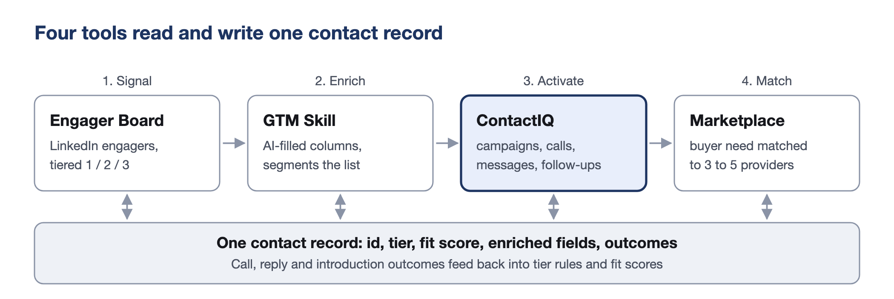
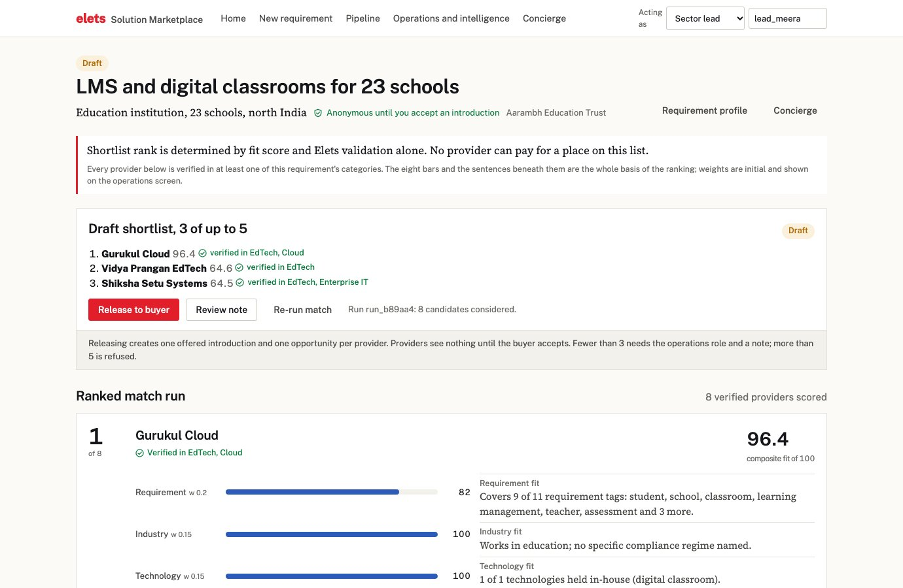
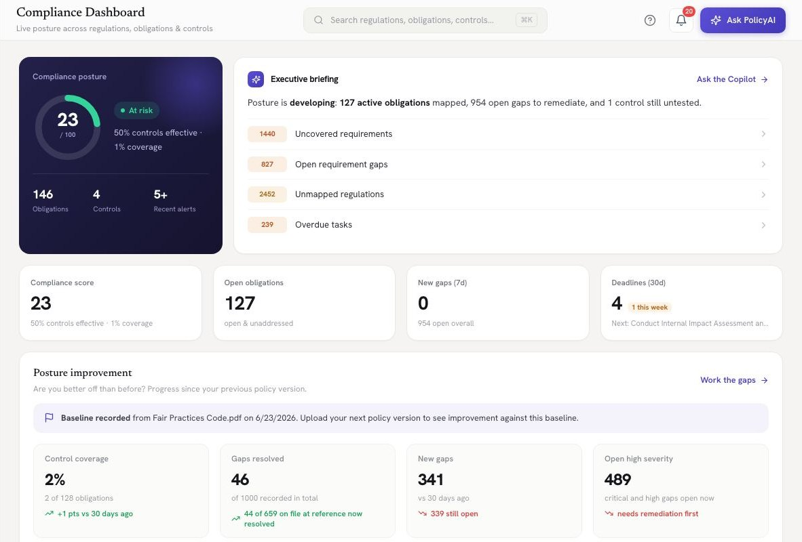
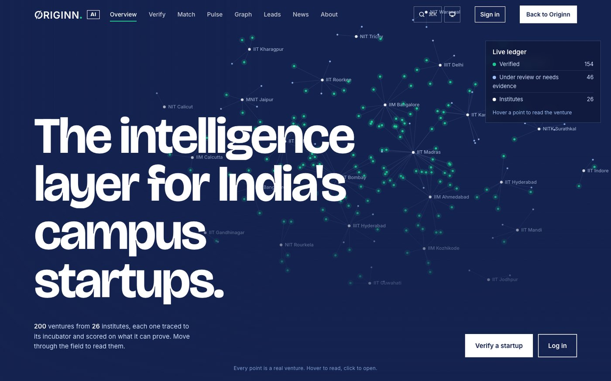

# Product PRDs and Briefs: Nishant Kumar

One full PRD (the Elets GTM Intelligence Stack) followed by four product briefs in the same format: PolicyAI, FedE, Originn AI and Tender Agent. Screenshots are from the working products; contact details are cropped out. Everything in one file: [Product_PRDs_and_Briefs_Nishant_Kumar.pdf](pdf/Product_PRDs_and_Briefs_Nishant_Kumar.pdf).

| Document | Product type | Read | PDF |
| --- | --- | --- | --- |
| PRD: Elets GTM Intelligence Stack | B2B sales and matchmaking stack | [Read](#prd-elets-gtm-intelligence-stack) | [PDF](pdf/PRD_Elets_GTM_Intelligence_Stack.pdf) |
| Brief: PolicyAI | Regulatory compliance copilot, B2B SaaS | [Read](#brief-policyai) | [PDF](pdf/Brief_PolicyAI.pdf) |
| Brief: FedE | Conversational AI for delivery customers | [Read](#brief-fede) | [PDF](pdf/Brief_FedE.pdf) |
| Brief: Originn AI | Intelligence layer for campus startups | [Read](#brief-originn-ai) | [PDF](pdf/Brief_Originn_AI.pdf) |
| Brief: Tender Agent | Government tender search | [Read](#brief-tender-agent) | [PDF](pdf/Brief_Tender_Agent.pdf) |

---

# PRD: Elets GTM Intelligence Stack

**Author:** Nishant Kumar · **Date:** 15 Nov 2026 · **Status:** Draft for review

## Summary

Four tools built separately at Elets Technomedia become one go-to-market stack with a single contact record: GTM Engineering Skill (enrich), Engager Board (signal), ContactIQ (activate) and Solution Marketplace (match).

Elets sells summit seats, sponsorships and vendor introductions to BFSI, government, health and education buyers. Today each tool works alone, so a lead found in one place is retyped in the next. This PRD defines the hand-offs, the shared record and the metrics that make the four behave as one product.

| Product | Job in the stack | State today |
| --- | --- | --- |
| [GTM Engineering Skill](https://github.com/CHIKU1799/GTM-skill) | Enrich and segment any prospect CSV with per-row AI answers | Open source, 30 automated tests, 50+ parallel calls for 25K-row lists |
| Engager Board | Turn LinkedIn post engagers into Tier 1/2/3 leads | Live, with per-post spend and cost per qualified lead |
| ContactIQ (shipped as eConnect) | Search, call lists, campaigns, messages and follow-ups over the firm's contacts | Running on about 12,000 contacts, with My day, Campaigns, Team and Data health |
| Solution Marketplace | Match buyer requirements to vetted solution providers | Live demo, 9 screens, 8-stage opportunity pipeline |

*ContactIQ (shipped as eConnect): plain-language search over the contact base. Result rows are cropped out to protect contact details.*

## Problem and opportunity

Sales reps lose time moving the same person between spreadsheets, LinkedIn and call sheets, and management cannot see which signals turn into revenue.

- **Fragmented records.** Contacts arrive from event registrations, Drive workbooks and LinkedIn engagement, each with its own columns and duplicates.
- **No qualification before spend.** Paid enrichment and rep time go to people who were never buyers, such as agencies and freelancers.
- **No per-edition pipeline.** Elets sells edition by edition, yet there was no daily plan, campaign view or follow-up date per summit.
- **No closed loop.** Outcomes of calls and introductions do not flow back to improve who gets targeted next.

The opportunity is that every piece already exists. Linking them costs integration work, not a new build.

## Users and jobs to be done

| User | Job to be done | Where it happens |
| --- | --- | --- |
| Sales rep | Know who to call today, with context and a ready message | ContactIQ: My day, drawer, message box |
| Sales-ops lead | Build a clean target list for each summit edition | GTM Engineering Skill, then ContactIQ Campaigns |
| Marketing | Find people already engaging with Elets topics | Engager Board |
| Sector lead | Validate a buyer requirement and approve a shortlist of 3 to 5 providers | Solution Marketplace |
| Management | See pipeline, team activity and cost per qualified lead in one place | ContactIQ Team, Engager Board Analytics |

## How the four products link

A lead enters as a signal, is enriched, is worked by a rep in ContactIQ and, where there is a buying need, is matched in the Marketplace. Every tool reads and writes the same record, so nothing is retyped and outcomes improve the next list.

*Solution Marketplace: a draft shortlist ranked by fit score alone, on sample data.*

## Requirements

Each product keeps its own job; the new work is the hand-offs marked "Next".

| Product | Shipped today | Next (this PRD) | Priority |
| --- | --- | --- | --- |
| GTM Engineering Skill | Drop any CSV, ask a question, get a new AI-filled column; website crawl per company; cost estimate before a run; retry and backoff | Run as a ContactIQ action on a saved list, writing answers back as fields on the contact record | P0 |
| Engager Board | Post, company and profile imports; tiering from structured job title; per-post analytics; server-signed spend quote before any paid run | Push Tier 1 and Tier 2 leads into a ContactIQ campaign with the source post attached | P0 |
| ContactIQ | Smart search with a 1 to 99 fit score and reason; call lists; campaigns with stages; WhatsApp and email drafts; follow-up dates; My day; Team; Data health; CSV and XLSX import | One contact id shared by all four tools; dedupe on import from Engager Board; outcome codes exposed to the other tools | P0 |
| Solution Marketplace | Requirement intake, lead quality score, 8-dimension fit score, sector-lead validation, buyer-gated introduction, 8-stage pipeline | Pull provider and buyer contacts from ContactIQ; write introduction outcomes back to the contact timeline | P1 |
| Shared | File-backed stores per tool | Nightly outcome feed: calls, replies and introductions adjust tier rules and fit scores | P2 |

Non-goals for this release: automated sending without a human approving the message, a mobile app, and billing.

## Success metrics and guardrails

The north-star metric is qualified conversations per rep per week, measured from ContactIQ outcome logs. Targets below are proposals to confirm after two weeks of baseline data.

| Metric | Source | Proposed target |
| --- | --- | --- |
| Qualified conversations per rep per week | ContactIQ outreach log | Baseline first, then +30% in 90 days |
| Cost per qualified lead | Engager Board Analytics | Tracked per post; stop sources above 2x the median |
| Time from signal to first touch | Engager Board import time to first ContactIQ outcome | Under 2 working days |
| Duplicate rate on import | ContactIQ Data health | Under 3% |
| Introductions accepted by buyers | Solution Marketplace pipeline | Baseline in Phase 0 concierge |

Guardrails:

- **Consent and privacy.** Event attendee data never becomes a sales lead automatically, in line with India's DPDP Act. Phone numbers and emails stay inside ContactIQ behind login.
- **Spend control.** Every paid scrape or enrichment needs a server-signed quote for the exact parameters before it runs.
- **Human in the loop.** AI drafts messages; a person approves and sends.
- **Integrity wall.** Paid visibility never changes Marketplace shortlist rank.

## Rollout, risks and open questions

1. **Weeks 1 to 2: shared record.** One contact id across tools, dedupe rules, and removal of demo users and seed data from ContactIQ.
2. **Weeks 3 to 4: signal to activate.** Engager Board pushes tiered leads into ContactIQ campaigns; pilot with one summit edition and three reps.
3. **Weeks 5 to 6: enrich in place.** GTM Engineering Skill runs on saved lists inside ContactIQ.
4. **Weeks 7 to 10: match.** Marketplace reads and writes ContactIQ; Phase 0 concierge runs on real requirements.
5. **Day 90: gate.** Continue only if qualified conversations per rep rose against baseline.

| Risk | Mitigation |
| --- | --- |
| Tier rules were written for a different customer profile | Rewrite Tier 1 and Tier 2 title lists for Elets buyers before the pilot |
| Engager Board has been tested on small real runs only | Run one paid extraction on a real Elets post before week 3 |
| Stores are file-backed and will not scale past one team | Move ContactIQ to Postgres before a second team joins |
| LinkedIn data access terms can change | Keep event registrations and imports as the primary source |

Open questions:

- Who owns tier rules: sales-ops or each sector lead?
- Should Marketplace introductions count toward rep targets?
- Which summit edition is the pilot?

---

# Brief: PolicyAI

**Live:** policyai.com · **Role:** built end to end at Elets Technomedia

| | |
| --- | --- |
| **Problem** | Compliance teams at Indian banks, NBFCs and brokers read every new circular by hand and cannot say which of their own policies it breaks. |
| **Users** | Compliance officers and risk heads at regulated BFSI firms. |
| **What shipped** | Continuous ingestion of 2,900+ documents from 9 regulators with 6-hourly re-crawls; a 2,800+-node knowledge graph; obligations mapped to each firm's uploaded policies; gap analysis, tasks and a copilot that cites the source paragraph; multi-tenant workspaces. |
| **Evidence** | Retrieval hit@10 rose from 0.914 to 0.971 on a judged 35-query set; full-text search went from 10.6 s to 0.63 s; a per-customer cost model puts the Starter plan at about 87% gross margin (modelled, not invoiced). |
| **Next** | Per-workspace usage metering, enforced seat and question quotas, and extraction and answer-quality evaluations run on the full gold set. |

---

# Brief: FedE

**Context:** FedEx Digithon, Round-3 live finalist · **Role:** agentic AI and secure-by-design lead on the team

| | |
| --- | --- |
| **Problem** | Customers learn about a delayed parcel after it is late, then wait in an IVR queue to change the delivery. |
| **Users** | Delivery customers first; support agents and operations second. |
| **What shipped** | A 9-tool planner agent over text, voice and barcode; weather-aware rerouting across a 16-hub network; delivery commitments ("before Friday") that the system watches; proactive fleet alerts; reschedule, hold, redirect and cancel from one screen. |
| **Guardrails** | Three autonomy tiers: cancel and redirect always need explicit customer confirmation held by the platform; role-based access; a 99-test suite in CI. |
| **Evidence** | Demo data only. Cost avoided is tracked at $17.78 per failed delivery attempt, used as a benchmark and not a measured saving. |
| **Next** | Sentiment analytics and milestone notifications are on the roadmap, not shipped. |

---

# Brief: Originn AI

**Live:** originn-ai.vercel.app · **Role:** Co-Founder and AI Lead, Originn (originn.co.in)

| | |
| --- | --- |
| **Problem** | Campus startups are hard to verify and hard to find, and founders miss grants and programmes they qualify for. |
| **Users** | Student founders, incubator managers and early-stage investors. |
| **What shipped** | Verify (a trust score from seven checks), Match (open grants and programmes ranked per venture with a reason), Pulse (sector and institute momentum) and Graph (institutes, ventures, sectors, investors), over 200 startups from 26 institutes and a live opportunities feed. |
| **Evidence** | The Originn platform reached 100+ startups and 1,000+ students across two campuses. Paid plans on Originn AI are a preview; no revenue is claimed. |
| **Next** | Real accounts and payments, and the evaluation engine wired into incubator application review. |

---

# Brief: Tender Agent

**Live:** tender-agent-dashboard.vercel.app · **Role:** built at Elets Technomedia

| | |
| --- | --- |
| **Problem** | Government tenders in India sit on dozens of central, state and PSU portals, each with its own format and date style. |
| **Users** | Bid teams at vendors, and Elets sector leads tracking public demand. |
| **What shipped** | Crawlers for 44 portals, one cleaned schema, industry classification, search with deadline and value filters, insights, and a signed-in dashboard. |
| **Evidence** | 138,350 tenders and contracts consolidated, including 77,648 awarded contracts. The dataset is from April 2026. |
| **Next** | Scheduled refresh in the hosted version and award-winner extraction to show who won comparable bids. |
