# Product PRDs and Briefs: Nishant Kumar

Two full PRDs (the Elets GTM Intelligence Stack and Originn AI) and three product briefs in the same format: PolicyAI, FedE and Tender Agent. Screenshots are from the working products; contact details are cropped out. Everything in one file: [Product_PRDs_and_Briefs_Nishant_Kumar.pdf](pdf/Product_PRDs_and_Briefs_Nishant_Kumar.pdf).

| Document | Product type | Read | PDF |
| --- | --- | --- | --- |
| PRD: Elets GTM Intelligence Stack | B2B sales and matchmaking stack | [Read](#prd-elets-gtm-intelligence-stack) | [PDF](pdf/PRD_Elets_GTM_Intelligence_Stack.pdf) |
| Brief: PolicyAI | Regulatory compliance copilot, B2B SaaS | [Read](#brief-policyai) | [PDF](pdf/Brief_PolicyAI.pdf) |
| Brief: FedE | Conversational AI for delivery customers | [Read](#brief-fede) | [PDF](pdf/Brief_FedE.pdf) |
| PRD: Originn AI | Intelligence layer for campus startups | [Read](#prd-originn-ai) | [PDF](pdf/PRD_Originn_AI.pdf) |
| Brief: Tender Agent | Government tender search | [Read](#brief-tender-agent) | [PDF](pdf/Brief_Tender_Agent.pdf) |

---

# PRD: Elets GTM Intelligence Stack

**Author:** Nishant Kumar · **Date:** 15 Nov 2026 · **Status:** Draft for review

## Summary

Four tools built separately at Elets Technomedia become one go-to-market stack with a single contact record: GTM Engineering Skill (enrich), Engager Board (signal), ContactIQ (activate) and Solution Marketplace (match).

Elets sells summit seats, sponsorships and vendor introductions to BFSI, government, health and education buyers. Today each tool works alone, so a lead found in one place is retyped in the next. This PRD defines the hand-offs, the shared record and the metrics that make the four behave as one product.

| Product | Job in the stack | State today |
| --- | --- | --- |
| [GTM Engineering Skill](https://github.com/CHIKU1799/GTM-skill) | Enrich and segment any prospect CSV with per-row AI answers | Open source, 30 automated tests, 50+ parallel calls for 25K-row lists |
| Engager Board | Turn LinkedIn post engagers into Tier 1/2/3 leads | Live, with per-post spend and cost per qualified lead |
| ContactIQ (shipped as eConnect) | Search, call lists, campaigns, messages and follow-ups over the firm's contacts | Running on about 12,000 contacts, with My day, Campaigns, Team and Data health |
| Solution Marketplace | Match buyer requirements to vetted solution providers | Live demo, 9 screens, 8-stage opportunity pipeline |

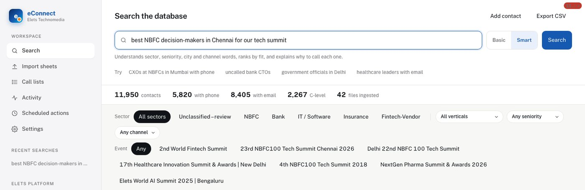

*ContactIQ (shipped as eConnect): plain-language search over the contact base. Result rows are cropped out to protect contact details.*

## Problem and opportunity

Sales reps lose time moving the same person between spreadsheets, LinkedIn and call sheets, and management cannot see which signals turn into revenue.

- **Fragmented records.** Contacts arrive from event registrations, Drive workbooks and LinkedIn engagement, each with its own columns and duplicates.
- **No qualification before spend.** Paid enrichment and rep time go to people who were never buyers, such as agencies and freelancers.
- **No per-edition pipeline.** Elets sells edition by edition, yet there was no daily plan, campaign view or follow-up date per summit.
- **No closed loop.** Outcomes of calls and introductions do not flow back to improve who gets targeted next.

The opportunity is that every piece already exists. Linking them costs integration work, not a new build.

## Users and jobs to be done

| User | Job to be done | Where it happens |
| --- | --- | --- |
| Sales rep | Know who to call today, with context and a ready message | ContactIQ: My day, drawer, message box |
| Sales-ops lead | Build a clean target list for each summit edition | GTM Engineering Skill, then ContactIQ Campaigns |
| Marketing | Find people already engaging with Elets topics | Engager Board |
| Sector lead | Validate a buyer requirement and approve a shortlist of 3 to 5 providers | Solution Marketplace |
| Management | See pipeline, team activity and cost per qualified lead in one place | ContactIQ Team, Engager Board Analytics |

## How the four products link

A lead enters as a signal, is enriched, is worked by a rep in ContactIQ and, where there is a buying need, is matched in the Marketplace. Every tool reads and writes the same record, so nothing is retyped and outcomes improve the next list.

*Solution Marketplace: a draft shortlist ranked by fit score alone, on sample data.*

## Requirements

Each product keeps its own job; the new work is the hand-offs marked "Next".

| Product | Shipped today | Next (this PRD) | Priority |
| --- | --- | --- | --- |
| GTM Engineering Skill | Drop any CSV, ask a question, get a new AI-filled column; website crawl per company; cost estimate before a run; retry and backoff | Run as a ContactIQ action on a saved list, writing answers back as fields on the contact record | P0 |
| Engager Board | Post, company and profile imports; tiering from structured job title; per-post analytics; server-signed spend quote before any paid run | Push Tier 1 and Tier 2 leads into a ContactIQ campaign with the source post attached | P0 |
| ContactIQ | Smart search with a 1 to 99 fit score and reason; call lists; campaigns with stages; WhatsApp and email drafts; follow-up dates; My day; Team; Data health; CSV and XLSX import | One contact id shared by all four tools; dedupe on import from Engager Board; outcome codes exposed to the other tools | P0 |
| Solution Marketplace | Requirement intake, lead quality score, 8-dimension fit score, sector-lead validation, buyer-gated introduction, 8-stage pipeline | Pull provider and buyer contacts from ContactIQ; write introduction outcomes back to the contact timeline | P1 |
| Shared | File-backed stores per tool | Nightly outcome feed: calls, replies and introductions adjust tier rules and fit scores | P2 |

Non-goals for this release: automated sending without a human approving the message, a mobile app, and billing.

## Success metrics and guardrails

The north-star metric is qualified conversations per rep per week, measured from ContactIQ outcome logs. Targets below are proposals to confirm after two weeks of baseline data.

| Metric | Source | Proposed target |
| --- | --- | --- |
| Qualified conversations per rep per week | ContactIQ outreach log | Baseline first, then +30% in 90 days |
| Cost per qualified lead | Engager Board Analytics | Tracked per post; stop sources above 2x the median |
| Time from signal to first touch | Engager Board import time to first ContactIQ outcome | Under 2 working days |
| Duplicate rate on import | ContactIQ Data health | Under 3% |
| Introductions accepted by buyers | Solution Marketplace pipeline | Baseline in Phase 0 concierge |

Guardrails:

- **Consent and privacy.** Event attendee data never becomes a sales lead automatically, in line with India's DPDP Act. Phone numbers and emails stay inside ContactIQ behind login.
- **Spend control.** Every paid scrape or enrichment needs a server-signed quote for the exact parameters before it runs.
- **Human in the loop.** AI drafts messages; a person approves and sends.
- **Integrity wall.** Paid visibility never changes Marketplace shortlist rank.

## Rollout, risks and open questions

1. **Weeks 1 to 2: shared record.** One contact id across tools, dedupe rules, and removal of demo users and seed data from ContactIQ.
2. **Weeks 3 to 4: signal to activate.** Engager Board pushes tiered leads into ContactIQ campaigns; pilot with one summit edition and three reps.
3. **Weeks 5 to 6: enrich in place.** GTM Engineering Skill runs on saved lists inside ContactIQ.
4. **Weeks 7 to 10: match.** Marketplace reads and writes ContactIQ; Phase 0 concierge runs on real requirements.
5. **Day 90: gate.** Continue only if qualified conversations per rep rose against baseline.

| Risk | Mitigation |
| --- | --- |
| Tier rules were written for a different customer profile | Rewrite Tier 1 and Tier 2 title lists for Elets buyers before the pilot |
| Engager Board has been tested on small real runs only | Run one paid extraction on a real Elets post before week 3 |
| Stores are file-backed and will not scale past one team | Move ContactIQ to Postgres before a second team joins |
| LinkedIn data access terms can change | Keep event registrations and imports as the primary source |

Open questions:

- Who owns tier rules: sales-ops or each sector lead?
- Should Marketplace introductions count toward rep targets?
- Which summit edition is the pilot?

---

# Brief: PolicyAI

**Live:** policyai.com · **Role:** built end to end at Elets Technomedia

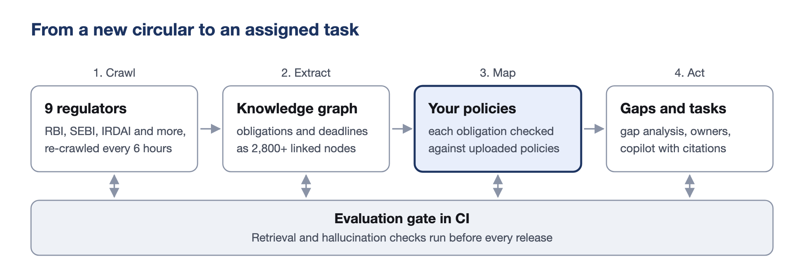

| | |
| --- | --- |
| **Problem** | Compliance teams at Indian banks, NBFCs and brokers read every new circular by hand and cannot say which of their own policies it breaks. |
| **Users** | Compliance officers and risk heads at regulated BFSI firms. |
| **What shipped** | Continuous ingestion of 2,900+ documents from 9 regulators with 6-hourly re-crawls; a 2,800+-node knowledge graph; obligations mapped to each firm's uploaded policies; gap analysis, tasks and a copilot that cites the source paragraph; multi-tenant workspaces. |
| **Evidence** | Retrieval hit@10 rose from 0.914 to 0.971 on a judged 35-query set; full-text search went from 10.6 s to 0.63 s; a per-customer cost model puts the Starter plan at about 87% gross margin (modelled, not invoiced). |
| **Next** | Per-workspace usage metering, enforced seat and question quotas, and extraction and answer-quality evaluations run on the full gold set. |

---

# Brief: FedE

**Context:** FedEx Digithon, Round-3 live finalist · **Role:** agentic AI and secure-by-design lead on the team

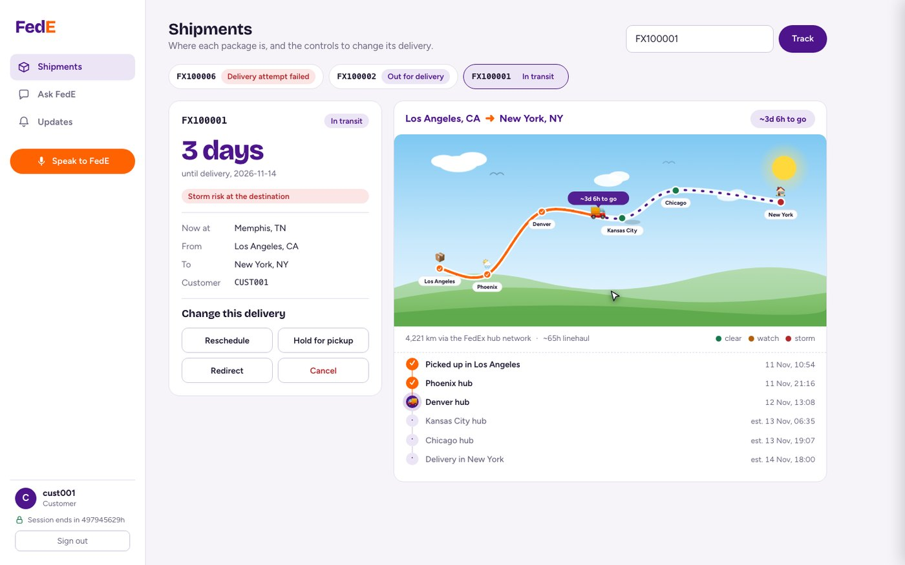

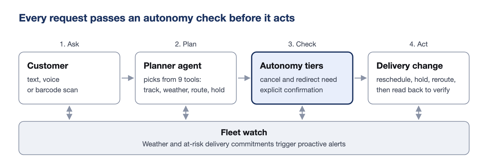

| | |
| --- | --- |
| **Problem** | Customers learn about a delayed parcel after it is late, then wait in an IVR queue to change the delivery. |
| **Users** | Delivery customers first; support agents and operations second. |
| **What shipped** | A 9-tool planner agent over text, voice and barcode; weather-aware rerouting across a 16-hub network; delivery commitments ("before Friday") that the system watches; proactive fleet alerts; reschedule, hold, redirect and cancel from one screen. |
| **Guardrails** | Three autonomy tiers: cancel and redirect always need explicit customer confirmation held by the platform; role-based access; a 99-test suite in CI. |
| **Evidence** | Demo data only. Cost avoided is tracked at $17.78 per failed delivery attempt, used as a benchmark and not a measured saving. |
| **Next** | Sentiment analytics and milestone notifications are on the roadmap, not shipped. |

---

# PRD: Originn AI

**Live:** [originn-ai.vercel.app](https://originn-ai.vercel.app) · **Role:** Co-Founder and AI Lead, Originn ([originn.co.in](https://www.originn.co.in)) · **Status:** live preview, accounts and checkout are demo-only

## Summary

Originn AI is the verification and intelligence layer of Originn: it scores, matches and maps India's campus-built startups so that founders, incubators and investors can act on evidence. It covers 200 ventures from 26 institutes, a live feed of grants and programmes, and a directory of 11,327 industry decision makers.

## Problem

- **Hard to verify.** A campus startup's claims (incubator, founders, traction) are scattered across sites and cannot be checked quickly.
- **Hard to find money.** Founders miss grants, fellowships and accelerators they qualify for because deadlines and eligibility sit on dozens of official pages.
- **Hard to see the field.** Incubators and investors have no single view of which sectors and institutes are moving this year.
- **Hard to reach buyers.** Student founders have no route to industry decision makers for pilots and first customers.

## Users

| User | What they need | Tool |
| --- | --- | --- |
| Student founder | Programmes they qualify for, and a credible public record | Match, Verify |
| Incubator manager | Faster first-screen review and a view of their cohort | Verify, Pulse |
| Investor or corporate scout | A shortlist of verified ventures and the people behind them | Graph, Leads |
| Originn team | Which ventures to feature, invite or follow up with | Pulse |

## How it works

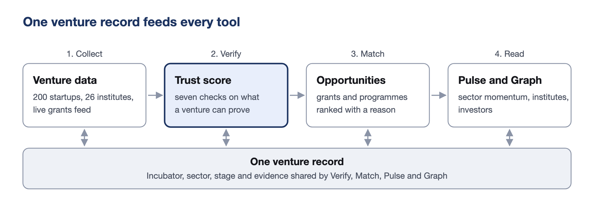

## Features shipped

### 1. Verify: a trust score from seven checks

Every venture on the ledger gets a score out of 100 built from seven explainable checks, such as web presence, incubator record traced to an institute, named founders and activity in the last 12 months. Each check shows what it looked at and what it found. A form scores a venture that is not yet listed (Pro).

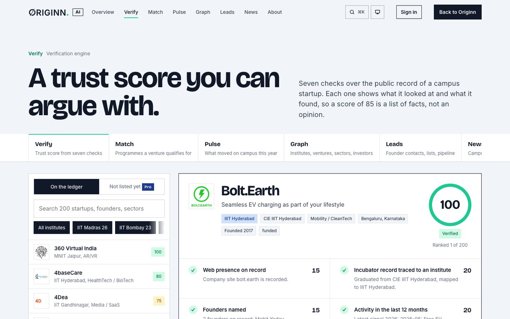

### 2. Match: grants and programmes ranked per venture

Every live opportunity in the Originn feed is scored for one venture. Sector overlap, stage fit, home state and eligibility windows add or remove points, and every line of reasoning is shown. Expired programmes drop out on their own. Filters cover challenge, seed fund, grant, fellowship, accelerator, loan and credits. "Describe a venture" matching is a Pro feature.

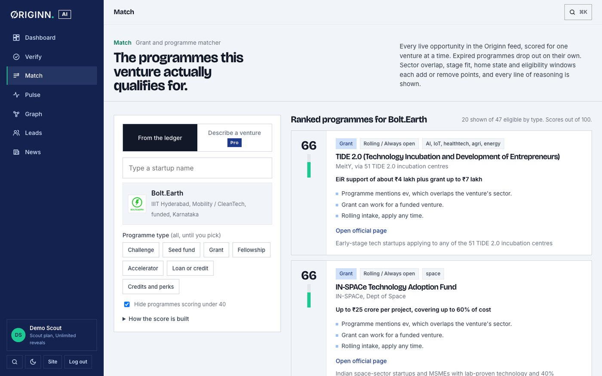

### 3. Pulse: what moved on campus this year

Sector momentum, institute output, stage mix and dated 2026 moves, computed from the ledger. Four "signal to play" cards turn each cohort into an action for the Originn team: invite to list a pre-order product, feature in Trending, open a collaboration call, or ask founders to complete the record.

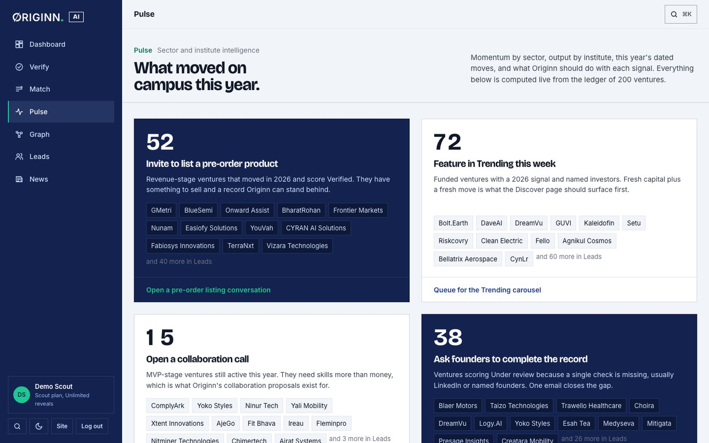

### 4. Graph: who built what, where, with whose money

A force-directed graph of 293 points and 536 links: institutes, ventures, sectors and investors who back more than one venture. Focus mode dims everything except a point's neighbours; search, drag and zoom are supported. The investor layer is a Pro feature.

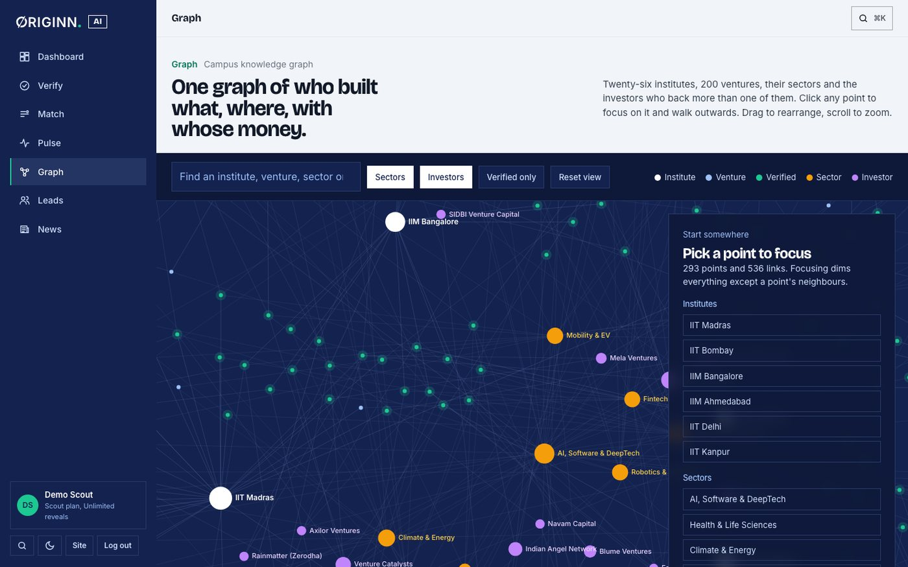

### 5. Leads: founders and industry decision makers

A directory of 11,327 industry decision makers plus the founders and companies on the campus ledger. Users filter by vertical, seniority, sector, location and event, then reveal a profile against a monthly credit allowance. Saved lists, a pipeline board, analytics, import of the user's own contacts and CSV export (Scout plan) are included. Phone numbers and emails are not held in the site; a reveal shows what is on file and routes the introduction through Originn.

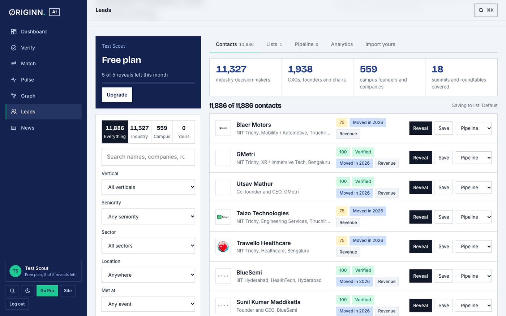

### 6. News: a campus startup newsroom

Funding, grants, policy and deeptech news pulled live from eight sources, sorted by desk (Campus, Funding, Grants and programmes, Policy, Deeptech, Global) and tied back to institutes on the ledger. A "closing soon" panel links to Match.

### 7. Dashboard and app shell

After sign-in the tools sit in one sidebar app. The dashboard shows shortcuts, ledger counts, the user's pipeline and lists, programmes closing soon, ventures that moved, and campus news. A command palette (Cmd+K) searches everything, and there is a light, dark and system theme.

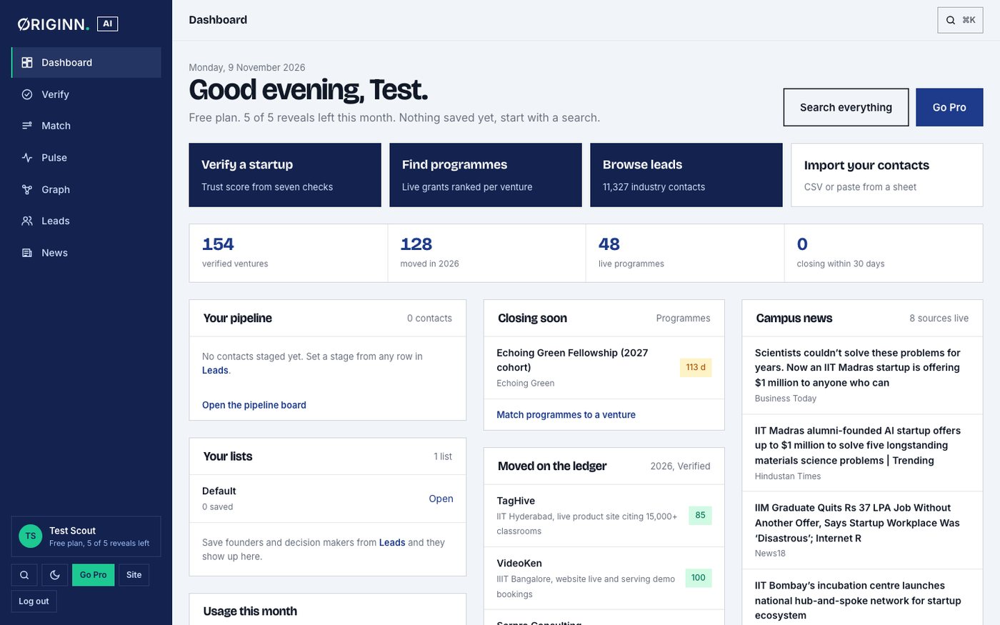

### 8. Accounts, plans and the teaser wall

The landing page, About, News and Verify are open. Match, Pulse, Graph and Leads show a blurred preview with inline sign-up, so visitors see the value before creating an account. Three plans are defined.

| Plan | Price | Includes |
| --- | --- | --- |
| Free | ₹0 | 5 contact reveals a month, core tools with 5 results, 1 saved list, pipeline board |
| Pro | ₹1,499 a month | 60 reveals, Pro tools (score unlisted ventures, describe-a-venture matching, full play lists, investor graph, weekly brief), 10 lists, pipeline analytics |
| Scout | ₹4,999 a month | Unlimited reveals and lists, all Pro tools, CSV export |

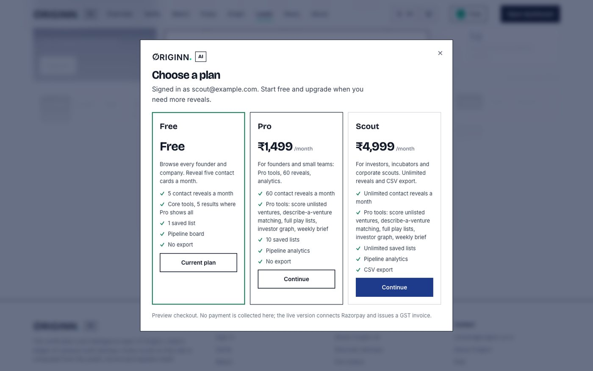

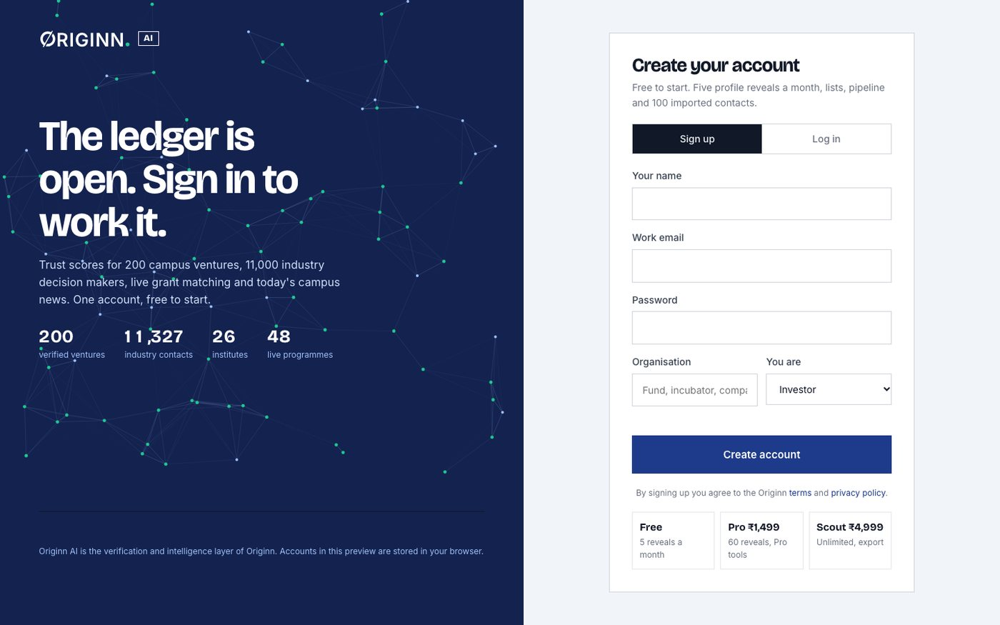

### 9. Landing page, About and walkthrough film

A live campus-graph hero (200 ventures orbiting 26 institutes, cursor-reactive), a scroll-driven statement, a pinned tool strip, a 20-second motion reel, a narrated walkthrough film and an About page.

## What is real and what is preview

| Area | State |
| --- | --- |
| Venture data, trust scores, matching, pulse, graph, news feed | Live, computed from real data |
| Accounts | Stored in the visitor's browser only |
| Checkout | Preview; no payment is collected and no revenue is claimed |
| Contact reveals | Show on-file flags and an introduction route, not raw phone numbers or emails |

## Success metrics

Targets are proposals; nothing below is measured yet except where stated.

| Metric | Why it matters | Proposed target |
| --- | --- | --- |
| Ventures with a Verified score | Trust is the product | 154 of 200 today; 500 verified within two quarters |
| Review time per application at an incubator | The evaluation engine is designed to cut first review from 2 hours to under 10 minutes | Measure in a pilot with one incubator |
| Matches that lead to an application | Shows Match is useful, not just accurate | 20% of signed-in founders apply to one matched programme |
| Free to Pro conversion | Tests the pricing | 3 to 5% after real payments launch |
| Weekly active signed-in users | Habit | Baseline after real accounts launch |

## Roadmap: what can be done next

| Horizon | Item | Outcome |
| --- | --- | --- |
| Now | Real accounts and database (Supabase) and payments with GST invoices (Razorpay) | Plans can be sold; usage is measurable |
| Now | Founder claim flow: a founder claims the venture page and uploads evidence for missing checks | Scores improve from the source; 46 ventures under review get resolved |
| Now | Wire the Level 1 screener and multi-agent evaluator into incubator application review | Review time falls from hours to minutes, with an explained score |
| Next | Automated daily refresh of the opportunities feed and deadline alerts by email and WhatsApp | Founders stop missing deadlines |
| Next | Weekly brief email (already promised on the News page) | Retention loop for Pro users |
| Next | Scale the ledger from 200 to 1,000+ ventures and add NITs and state universities not yet covered | Coverage that investors can rely on |
| Next | Warm introductions: a tracked request from an investor or corporate to a founder, with consent on both sides | Leads becomes a marketplace, not a directory |
| Later | Verified badge and trust score embedded on originn.co.in startup pages and as a shareable badge | Verification becomes visible where students and partners browse |
| Later | Investor and corporate workspaces: saved theses, alerts when a matching venture moves | The Scout plan earns its price |
| Later | Public API and incubator dashboards (cohort health, programme coverage, alumni outcomes) | Institutional revenue line |
| Later | Talent matching: students matched to startup roles, linked with QuicklyHired | Closes the loop with Originn's recruiting product |

## Risks and open questions

| Risk | Mitigation |
| --- | --- |
| Scores rest on public records and can be wrong | Every check is shown with its evidence; founders can contest and add proof |
| Personal data in the directory | Contact details stay off the public site; reveals go through Originn; consent recorded before any introduction |
| Opportunity deadlines go stale | Only official pages are used; expired items hide automatically; daily refresh planned |
| Willingness to pay is untested | Run a paid pilot with 10 founders and 3 investors before building billing in depth |

Open questions: who verifies a claim when the incubator does not respond, and should incubators pay per seat or per cohort?

---

# Brief: Tender Agent

**Live:** tender-agent-dashboard.vercel.app · **Role:** built at Elets Technomedia

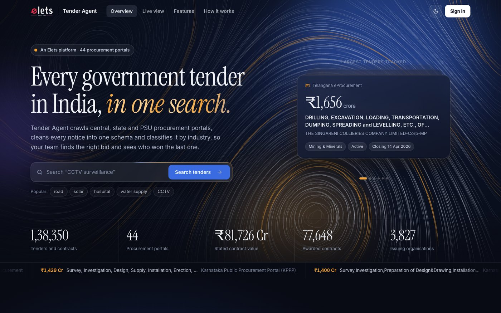

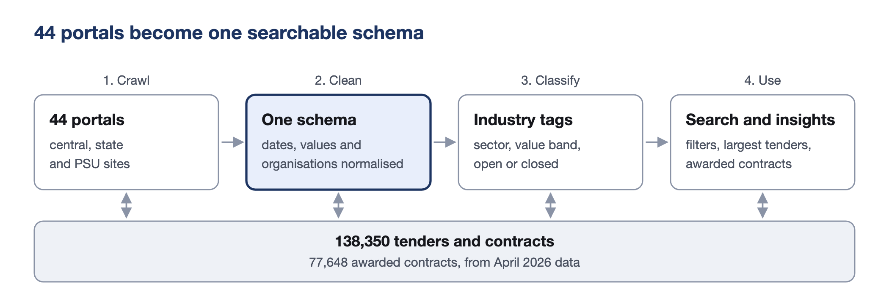

| | |
| --- | --- |
| **Problem** | Government tenders in India sit on dozens of central, state and PSU portals, each with its own format and date style. |
| **Users** | Bid teams at vendors, and Elets sector leads tracking public demand. |
| **What shipped** | Crawlers for 44 portals, one cleaned schema, industry classification, search with deadline and value filters, insights, and a signed-in dashboard. |
| **Evidence** | 138,350 tenders and contracts consolidated, including 77,648 awarded contracts. The dataset is from April 2026. |
| **Next** | Scheduled refresh in the hosted version and award-winner extraction to show who won comparable bids. |
